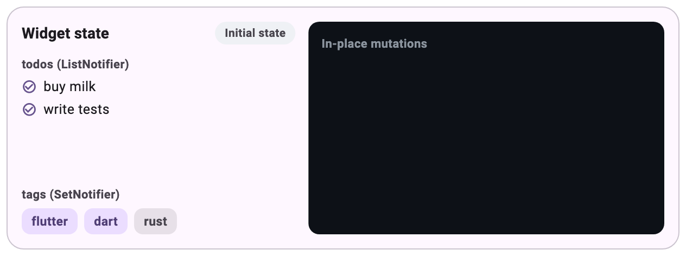

# collection_notifiers

[![pub][pub-badge]][pub] [![pub points][points-badge]][points]
[![CI][ci-badge]][ci] [![license][license-badge]](LICENSE)

`List`, `Set`, `Map` and `Queue` that notify their listeners when their contents
change. Edit the collection in place — `add`, `remove`, `[]=` — and your widgets
rebuild only when something really changed.



## Quick start

```sh
flutter pub add collection_notifiers flutter_hooks material_ui
```

```dart
import 'package:collection_notifiers/collection_notifiers.dart';
import 'package:material_ui/material_ui.dart';
import 'package:flutter_hooks/flutter_hooks.dart';

class const TodoList({super.key}) extends HookWidget {
  @override
  Widget build(BuildContext context) {
    final todos = useListNotifier<String>(['buy milk']);
    return Column(
      children: [
        FilledButton(
          onPressed: () => todos.add('walk dog'),
          child: const Text('Add'),
        ),
        for (final todo in todos) Text(todo),
      ],
    );
  }
}
```

Tapping **Add** appends to the list in place and rebuilds `TodoList`. The hook
creates the notifier on the first build and disposes it when the widget leaves
the tree. `flutter_hooks` provides `HookWidget`; to skip hooks, see
[Without hooks](doc/widgets.md#without-hooks).

## Pick the notifier

| Need | Class | Hook |
| --- | --- | --- |
| Ordered, indexable, reorderable | `ListNotifier` | `useListNotifier` |
| Unique elements, selection toggles | `SetNotifier` | `useSetNotifier` |
| Key → value lookup | `MapNotifier` | `useMapNotifier` |
| FIFO/LIFO head-or-tail mutation | `QueueNotifier` | `useQueueNotifier` |

## Guides

- [Widgets and state management](doc/widgets.md) — when to use vs skip,
  `DelegatingX` / equality semantics, hooks lifecycle & `keys`,
  `ValueListenableBuilder`, and Riverpod.
- [Notification semantics and errors](doc/semantics.md) — when listeners are
  notified, `batch`, `assignAll`, `sort`/`shuffle`, and `StateError` /
  `ArgumentError` rules.
- [Recipes and pitfalls](doc/recipes.md) — multi-select `SetNotifier.invert`,
  `MapNotifier` settings, reorderable todos with `move`, pitfalls table, and 1.x
  → 2.x migration.

## Agent skill

This package ships an agent skill in `skills/collection-notifiers-usage/`.
Install it into your project's agent config with:

```sh
dart run skills@ get --package collection_notifiers --all
```

## Contributing

See [CONTRIBUTING.md](CONTRIBUTING.md).

## License

MIT — see [LICENSE](LICENSE).

[pub-badge]: https://img.shields.io/pub/v/collection_notifiers.svg
[pub]: https://pub.dev/packages/collection_notifiers
[points-badge]: https://img.shields.io/pub/points/collection_notifiers
[points]: https://pub.dev/packages/collection_notifiers/score
[ci-badge]:
  https://github.com/esenmx/collection_notifiers/actions/workflows/ci.yaml/badge.svg
[ci]: https://github.com/esenmx/collection_notifiers/actions/workflows/ci.yaml
[license-badge]: https://img.shields.io/badge/license-MIT-blue.svg
